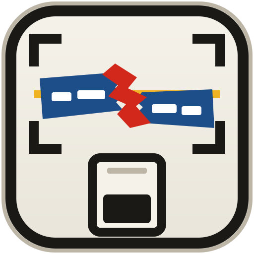

<div align="center">
  
  <h1>jaga 🧿</h1>
  <p><em>Type what to watch for. NVIDIA Cosmos-Embed1 watches a webcam on your laptop, and a cheap smart plug cuts power.</em></p>
  

  <p><em>jaga</em> is Indonesian for "to guard, to keep watch". No model training, no cloud video. Built on NVIDIA Cosmos.</p>

  <br/>

  [](https://jaga-ashy.vercel.app)
  [](https://jaga-ashy.vercel.app/pitch/)
  [](DEMO.md)
  [](docs/PROTOCOL.md)
  [](https://nebiusglobalaihackathon.devpost.com/)

  <br/>

  [](https://github.com/edycutjong/jaga/actions/workflows/ci.yml)
  
  
  
  
  [](LICENSE)

</div>

---

> **jaga is an extra guard, not a fire-safety device.** It can miss an event; a trip only ever cuts power or sends a
> notification, and switching power back on is always a person's job.


## 💡 The Problem & Solution

### The Problem

*A scenario (a composite, not a real person):* Bu Sari leaves the iron on when she runs to the warung (the corner
shop), and her CCTV stays silent — an empty room with a hot iron in it has no motion.

### The Solution

Type a sentence — *"nobody is at the ironing board"* — and jaga turns it into a watcher: NVIDIA Nemotron 3 Super
writes the captions, NVIDIA Cosmos-Embed1 matches them to the live camera on your laptop, deterministic code decides
when it is true for long enough, and a Wi-Fi smart plug cuts the power. The model chooses where to look; the code
decides when to act.


## 🏗️ Architecture & Tech Stack

### The one flow

1. You type a sentence: *"nobody is at the ironing board"*. The iron is plugged into a Wi-Fi smart plug.
2. **NVIDIA Nemotron 3 Super** (`nvidia/nemotron-3-super-120b-a12b`) on **Nebius Token Factory** compiles it, under a
   JSON schema, into a *TripwireSpec*: 3–5 short action-style English captions of what the camera sees when the
   sentence is true, 3–6 hard negatives of the same place when it is false, a dwell and an action. You see the
   captions and negatives before arming, and choose what happens (cut the plug, or notify) and the dwell.
3. **NVIDIA Cosmos-Embed1-224p** runs on the laptop. Every window of the last 8 frames, sampled at 1 frame per second,
   becomes one 256-d vector in the same space as the captions.
4. Deterministic code decides: margin = best positive cosine − best negative cosine; a trip needs most windows over the
   dwell above the threshold, including the newest. A 2-minute "normal state" capture at arming (someone ironing as
   usual) sets the reference.
5. The plug switches **off** over the home network, and the overlay shows OFF only after the plug confirms it.
   A **Nebius Serverless Job** recalibrates each tripwire's threshold from labelled margins (`jaga calibrate`); the
   threshold the pre-registered soaks use is fitted on the laptop from the labelled clips and frozen before them.

The model chooses where to look; the code decides when to act.

### Tech stack

| Layer | What |
|---|---|
| Perception | `nvidia/Cosmos-Embed1-224p` via `transformers`, fp32 on Apple MPS or CPU (`jaga/embed.py`) |
| Compiler | `nvidia/nemotron-3-super-120b-a12b` on Nebius Token Factory (`jaga/compile.py`) |
| Calibration | Nebius Serverless Job (`jobs/calibrate.py`, stdlib) + Object Storage |
| Watcher and overlay | Python 3.11, OpenCV capture at 1 fps, PyAV, FastAPI + SSE on `127.0.0.1:8765`, SQLite |
| Actuator | Tuya plug via `tinytuya`, or Shelly Plug S Gen3 local API |

## 🏆 NVIDIA & Nebius Integration

### How the NVIDIA models are used

| Model | Where | What it does in the flow |
|---|---|---|
| `nvidia/Cosmos-Embed1-224p` | on the laptop, fp32 on Apple MPS or CPU (`jaga/embed.py`) | `get_video_embeddings` turns each 8-frame window into a 256-d vector; `get_text_embeddings` puts the compiled captions in the same space, so a sentence becomes a classifier without training |
| `nvidia/nemotron-3-super-120b-a12b` | Nebius Token Factory (`jaga/compile.py`) | rewrites the sentence into the short English caption register the Cosmos-Embed1 card says aligns with video, and invents the hard negatives that turn "nobody" into a visual contrast; structured JSON output, so the code can enforce it |

The Cosmos-Embed1 card says it was tested only with BF16 on Ampere and Hopper GPUs under Linux; jaga runs it on macOS
in fp32, and the speeds in
`DEMO.md` are ours, measured on this laptop.

### Where Nebius is used

* **Token Factory** compiles every sentence (one request per compile attempt; a second request — another response
  format, or a retry — is sent only if the first fails: an HTTP error, an empty reply or an invalid spec. The request
  ID that produced the spec is stored with the tripwire, shown in the compile drawer and listed at `/receipts`). Each of the three tripwires to be measured was frozen from one compile made before any clip
  was recorded; earlier compiles are listed under `superseded` in its fixture (`fixtures/tripwires/`).
* **Serverless Jobs** (`cpu-d3`, `4vcpu-16gb`, stock `python:3.11`) run the calibration (`jobs/calibrate.py`,
  standard library only): a per-tripwire ROC over labelled margins → the threshold at recall 0.9. The work is light;
  running it as a Job keeps calibration off the watcher's machine and leaves a receipt for every run
  ([`docs/RUNS.md`](docs/RUNS.md)).
* **Object Storage** carries the Job's input and result through presigned URLs: the Job holds no account
  credential, only two single-object URLs that expire after 2 hours. A result is adopted only if it matches the input
  that was sent (run ID, input hash, row count) and its threshold is finite and in range.
* The overlay's **✗ wrong** marks on a trip are kept as labelled negatives. They change the precision and AUC the
  calibration reports; the threshold itself stays the highest margin that keeps recall ≥ 0.9.

### What leaves the laptop

| What | To | Contains video frames? |
|---|---|---|
| the typed sentence | Token Factory | no |
| labelled margins (numbers and labels; no vectors) | Object Storage → the calibration Job | no |
| thresholds | back from Object Storage | no |
| one text line per alert, only if you turn on the optional push: a trip (tripwire slot and name, time, seconds held) or a guard's short status (too dark, camera moved, watcher stopped, action failed). Anyone who knows the topic can read it, so jaga refuses topics shorter than 20 characters | ntfy | no |

**Video frames never leave this laptop.** The overlay is served on `127.0.0.1` only. The Tuya plug's own firmware
may talk to Tuya's cloud by itself; that is outside jaga's control, and the Shelly path can be fully local.

## 📊 Engineering Rigor

| Metric | Value |
|---|---|
| Tests | 187 (`pytest`): safety invariants, decision rule, measurement rules; no model or key needed (3 need ffmpeg on PATH and skip without it) |
| Decision rule, exhaustively | all 49,152 above/below patterns (4 strides × 3 dwells × 2¹² windows) match an independent oracle, and one window never trips — `tests/test_decision_exhaustive.py`; `scripts/mutation_check.py` breaks the rule 8 ways: the rule's tests catch 7, and the 8th cannot change its behaviour at the shipped settings (`evidence/runs/2026-10-17-decision-mutation.txt`) |
| Measured speed and accuracy | only in [`DEMO.md`](DEMO.md), written by `scripts/bench.py` |
| Pre-registered soaks | [`docs/PROTOCOL.md`](docs/PROTOCOL.md), committed before any data |

### Status

The software is built and tested against scripted vectors and fake plugs; the measurements are being made.

* Accuracy and speed results appear only in [`DEMO.md`](DEMO.md), written by `scripts/bench.py`. Job receipts and
  their timings are in [`docs/RUNS.md`](docs/RUNS.md), and the day-0 spikes in [`evidence/day0/`](evidence/day0/).
* **Not recorded yet:** the labelled clips and the pre-registered soaks — B1, B2 and the supporting Soak A night
  (protocol committed before any data: [`docs/PROTOCOL.md`](docs/PROTOCOL.md)). `DEMO.md` says "not yet run" for
  each until it is measured.
* **Not run on the real hardware yet:** so far the live loop has run on recorded files played through the same
  capture path, and the plug path against fake plugs in the tests. The first runs with a real webcam and a real
  plug are pending.
* The calibration Job has run once, as a smoke test on synthetic numbers (`docs/RUNS.md`). Once labelled margins
  exist, a calibration run is started by hand (`jaga calibrate`, or `scripts/dispatch_calibrate.sh`); no scheduler is
  installed.

### Safety (it switches mains power)

* **I1** — a trip can only cut power or notify. The only code that can switch a plug on is `jaga/operator_on.py`,
  used only by operator actions: the overlay's `POST /plug/test` (localhost + same-origin + a per-run token) and the
  hand-run plug check `scripts/day0_plug.py`. Tests check statically that nothing else in the package reaches it,
  and run repeated trips against a fake plug to count zero ON calls.
* **I2** — one bad window cannot cut power: a trip needs most windows over the dwell above the threshold, including
  the newest, never fewer than two, and the dwell is never shorter than twice the p95 live window period (`DEMO.md` §1).
* **I3** — the overlay shows OFF only after the plug acknowledges this trip's OFF (a remembered plug state never
  stands in for it); a failed call is shown and pushed as **ACTION FAILED** and retried (off only). Every plug call —
  a trip's OFF, a status read, the operator test — takes one lock, so they never interleave.
* Guards: a sudden light change suspends trips; too dark unarms ("too dark to see") and nothing re-arms in the dark;
  a moved camera unarms and nothing re-arms until a new capture; a watchdog shows **WATCHER STOPPED** if windows stop,
  keep failing, or a watcher thread ends. Cutting power is only allowed for heating or cooking appliances (an iron, a
  stove, a heater, a kettle…); a fridge or a freezer can never be cut.

### Honest limits (5)

1. Three events are planned (iron, fridge, door) — plus a cat on the counter as tripwire 04 only if cat clips get
   recorded — one room, one person; not "any event". No detection accuracy has been measured yet (`DEMO.md` §2).
2. In the soak protocol the plug's visible load is a desk lamp and the iron is an unplugged prop: no heated iron is
   left unattended for a measurement.
3. 224p is small: jaga watches scene states (a person present or not, a door open), not an iron's power light.
4. Captions are English; other languages are only as good as Super's rewrite.
5. If the laptop sleeps or the camera is unplugged, nothing trips (the watchdog alerts while the process runs).

## 🚀 Getting Started

### Prerequisites

Python 3.11, a webcam, and (optionally) a Tuya or Shelly smart plug. Details are under Installation.

### Installation

```bash
git clone https://github.com/edycutjong/jaga && cd jaga
python3.11 -m venv .venv && source .venv/bin/activate
pip install -e ".[test]"
pytest       # 187 tests: the safety invariants, the decision rule and the measurement rules; no model or key needed (3 need ffmpeg)
```

**The model:** [`nvidia/Cosmos-Embed1-224p`](https://huggingface.co/nvidia/Cosmos-Embed1-224p), under the NVIDIA Open
Model License. On 2026-10-15 Hugging Face served it without a token (`evidence/day0/hf-access.json`); the card still
carries a licence prompt, so if a download is refused, accept the licence there and run `huggingface-cli login`. The
first run downloads the weights; after that jaga loads them from the local cache with no network call.

**The compiler:** a Nebius Token Factory key in `~/.config/jaga/tokenfactory.env` (`TOKENFACTORY_API_KEY=…`).

**The plug (optional for trying it):** a Tuya "Smart Life" Wi-Fi plug, paired in its app; then run the wizard once
inside `~/.config/jaga` (`cd ~/.config/jaga && python -m tinytuya wizard`). It writes `devices.json` (the plug's
local key) and your Tuya cloud API secret into the folder it runs in, so never run it inside the repo. jaga also has a
driver for the Shelly Plug S Gen3's local API (`~/.config/jaga/shelly.json` with `{"ip": "…"}`). Neither driver has
run against a real plug yet: the tests exercise the Shelly driver against a fake plug on the loopback network and the
Tuya driver through a fake `tinytuya` device. With no plug configured, a trip shows **ACTION FAILED** — never "done".

```bash
jaga serve --load 01 --arm 01                 # watch the webcam; open http://127.0.0.1:8765/
jaga serve --source recording.mp4 --load 01   # or play a recording through the same loop (--loop repeats it)
jaga compile "the door is left open and nobody is there"
```

On macOS, allow camera access for your terminal (System Settings → Privacy & Security → Camera).

## 🧪 Testing & CI

`pytest` runs the whole watcher — decision rule, guards, actuator, server — against scripted vectors and a fake LAN
plug. Scoring a recording works today with the model (one run on the model card's sample video is recorded in
`evidence/day0/score-run.json`):

```bash
jaga score my-clip.mp4 --tripwire fixtures/tripwires/01.json    # embeds one 8-s window with Cosmos-Embed1
```

**Available once the labelled clips are recorded:** each clip's window vector is committed under `fixtures/vecs/`,
and `jaga score --replay iron/pos_03 --tripwire fixtures/tripwires/01.json` then scores it with no model download, no
key and no camera. Until then `--replay` has nothing to read.

**CI** (`.github/workflows/`) runs on pushes to `main` and on pull requests, with no model download, no key and no camera:
ruff, `pip-audit`, `pytest` with coverage (Python 3.11 and 3.12 on `main`), then `scripts/verify_offline.py` (an armed
tripwire trips and a fake LAN plug is switched OFF while every non-LAN connection is refused; `--real` runs the same check
with the model and your plug) and
`scripts/check_submission_readiness.py`. `gitleaks` scans each push and pull request (`make secrets` scans the full history); CodeQL (Python) runs once the repository is
public, because code scanning is free only there. `mypy` runs as an informational step. The same steps (except mypy and gitleaks) run locally
with `make ci`; `make typecheck` and `make secrets` cover those two.

## 📁 Project Structure

| Path | What |
|---|---|
| `jaga/` | the package: embedder, capture, guards, decision rule, actuator, watcher, server, overlay, CLI |
| `jobs/calibrate.py` | the Serverless Job (stdlib) |
| `scripts/` | `bench.py` (every number), `seed.py` (fixtures), `protocol.py`, `verify_offline.py`, `check_submission_readiness.py`, day-0 stages |
| `fixtures/tripwires/` | the frozen tripwires with their Token Factory request IDs and caption vectors |
| `evidence/` | day-0 measurements and Job receipts |
| `docs/` | `PROTOCOL.md` (pre-registered), `RUNS.md` (Job receipts), `DX-REPORT.md` (friction log) |

## 📄 License

Apache-2.0 ([`LICENSE`](LICENSE)); see [`NOTICE`](NOTICE). Built on NVIDIA Cosmos.
